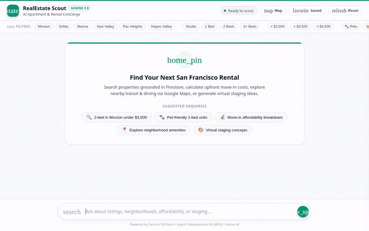

# RealEstate Scout 🏠🔍

> An intelligent apartment finding and real estate concierge powered by **Gemini 3.8 Flash**, the **Agent Development Kit (ADK)**, and **Google Cloud**.

🌐 **Public Live Demo**: [https://frontend-5464326154.us-central1.run.app](https://frontend-5464326154.us-central1.run.app)



---

## 🌟 What RealEstate Scout Does

RealEstate Scout is a conversational real estate and apartment hunting agent. Grounded in a live Google Cloud Firestore catalog of San Francisco rentals, it helps apartment seekers discover, evaluate, and virtually stage rental properties:

- **Filter & Search Rental Catalog**: Query available apartments by price ceiling, bedroom count, specific neighborhoods, and pet friendliness using structured database filtering.
- **Inspect Full Listing Specifications**: Retrieve detailed unit specifications including rent, square footage, bathrooms, amenities list, detailed unit descriptions, and in-person tour availability.
- **Calculate Upfront Costs & Affordability**: Compute complete upfront move-in cash requirements (first month's rent, security deposit, pet deposit), estimated monthly utility costs, and evaluate affordability against standard 3x income qualification rules.
- **Neighborhood Geocoding & Places Discovery**: Resolve addresses to coordinates and discover nearby points of interest (cafes, dining, grocery stores, transit stations, parks, gyms) via the Google Maps Places API (New) and OpenStreetMap Nominatim.
- **AI Virtual Staging & Visuals**: Generate photorealistic interior design and virtual staging concepts for rooms using Vertex AI image generation (`imagen-3.0-generate-002`), automatically uploaded and served via Google Cloud Storage.
- **Cinematic Property Tour Videos**: Generate dynamic video walkthrough previews for listings using Vertex AI video generation (`veo-2.0-generate-001`).
- **Save Favorite Listings**: Bookmark properties with custom user notes directly in Firestore.
- **Agent-to-User Interface (A2UI)**: Return rich visual display cards, columns, rows, and images following the A2UI v0.8 Basic Catalog specification.
- **Modern Web Chat Experience**: An interactive web frontend featuring a Leaflet OpenStreetMap neighborhood drawer, a persistent shortlist drawer with markdown export, comparison matrix modal, media lightbox, GFM table rendering, and quick-filter ribbon.

---

## ☁️ Google Cloud Services & Tools Wired Up

The capabilities below are backed by real Google Cloud services and tools implemented in `realestate-scout/app/tools.py`, `realestate-scout/app/agent.py`, and `agents-cli-manifest.yaml`:

| Service / Tool | Implementation in Codebase | Registered Function / Tool |
|---|---|---|
| **Google Cloud Firestore** | NoSQL database hosting the live `properties` catalog and `saved_favorites` collections. | `search_properties`<br/>`get_property_details`<br/>`add_property`<br/>`save_favorite_property` |
| **Google Cloud Storage (GCS)** | Object storage bucket (`realestate-scout-assets`) for storing and serving generated media assets. | Integrated into `generate_virtual_staging_image` and `generate_property_tour_video` |
| **Vertex AI Image Generation (Imagen)** | Generates photorealistic virtual room staging concepts using `imagen-3.0-generate-002`. | `generate_virtual_staging_image` |
| **Vertex AI Video Generation (Veo)** | Generates cinematic preview walkthrough tours using `veo-2.0-generate-001`. | `generate_property_tour_video` |
| **Vertex AI Agent Engine Code Sandbox** | Isolated cloud sandbox environment for executing dynamic Python code for financial modeling and data analysis. | `AgentEngineSandboxCodeExecutor` configured on `root_agent` |
| **Google Maps Places API (New)** | Spatial circle radius search for nearby transit, cafes, groceries, and dining. | `search_nearby_places` |
| **OpenStreetMap Nominatim** | Address geocoding and geographic boundary/postcode resolution. | `geocode_address`<br/>`lookup_neighborhood_map_info` |
| **Financial Affordability Calculator** | Python computation tool for move-in cash requirements, deposits, and income ratios. | `calculate_move_in_costs` |
| **Agent-to-User Interface (A2UI)** | Emits structured JSON surfaces following the A2UI v0.8 Basic Catalog. | `a2ui_callback` in `app/a2ui_utils.py` |

---

## 📋 Planned vs. Implemented Capabilities

To maintain full transparency with the initial design in `project_brief.md`:

| Capability | Initial Brief | Codebase Status | Description |
|---|---|---|---|
| **Firestore Rental Catalog** | Planned | ✅ **Implemented** | Live querying and detail retrieval from Firestore `properties`. |
| **Cloud Storage Asset Hosting** | Planned | ✅ **Implemented** | Auto-uploads generated media to `realestate-scout-assets`. |
| **Virtual Staging Image Gen** | Planned | ✅ **Implemented** | Active via Vertex AI `imagen-3.0-generate-002`. |
| **Property Video Tours** | Planned | ✅ **Implemented** | Active via Vertex AI `veo-2.0-generate-001`. |
| **A2UI Rich UI Cards** | Planned | ✅ **Implemented** | Emits A2UI v0.8 cards rendered natively in web chat. |
| **Google Maps & Places APIs** | Planned (stretch) | ✅ **Implemented** | Active via `geocode_address` and `search_nearby_places`. |
| **Move-In Cost Calculations** | Planned | ✅ **Implemented** | Active via `calculate_move_in_costs`. |
| **Agent Engine Code Sandbox** | Planned | ✅ **Implemented** | Active via `AgentEngineSandboxCodeExecutor`. |
| **Vertex AI Memory Bank** | Planned | ⏳ *Planned, not yet implemented* | Favorites and notes persist directly in Firestore `saved_favorites`. Cross-session semantic Memory Bank extraction is not yet wired up. |
| **Lease Document RAG Engine** | Planned (stretch) | ⏳ *Planned, not yet implemented* | Grounded document parsing over PDF lease agreements was identified as an optional stretch goal and is not yet implemented. |

---

## 🏗️ Project Architecture

```text
BuildWithGemini/
├── assets/
│   ├── build-with-gemini-banner.png
│   └── demo.gif                   # Looping recording of the running app
├── frontend/
│   ├── Dockerfile                 # Container definition for frontend deployment
│   ├── main.py                    # FastAPI proxy communicating via A2A protocol
│   ├── requirements.txt           # Frontend dependencies (fastapi, httpx, uvicorn)
│   └── static/
│       └── index.html             # Web chat UI with Leaflet map drawer, shortlist, and A2UI renderer
├── project_brief.md               # Initial design brief and tool planning
└── realestate-scout/
    ├── agents-cli-manifest.yaml   # ADK agent manifest (acli 1.4.0, A2A protocol)
    ├── pyproject.toml             # Python project dependencies
    ├── seed_firestore.py          # Script seeding SF rental listings into Firestore
    └── app/
        ├── agent.py               # Core ADK root_agent definition with Gemini 3.8 Flash
        ├── tools.py               # Firestore, Cloud Storage, Maps, and Vertex AI tools
        ├── a2ui_utils.py          # After-model callback formatting A2UI payloads
        ├── fast_api_app.py        # Local FastAPI agent runtime server with A2A routes
        └── app_utils/             # Service registry, A2A routes, and adapter utilities
```

---

## 🚀 Local Setup & Run Instructions

Follow these steps to run RealEstate Scout locally:

### 1. Prerequisites

- **Python 3.11+** installed
- **uv** or **pip**
- **Google Cloud SDK (`gcloud`)** authenticated with an active project:
  ```bash
  gcloud auth login
  gcloud auth application-default login
  gcloud config set project <YOUR_GCP_PROJECT_ID>
  ```
- Required Google Cloud APIs enabled: Vertex AI, Cloud Storage, Firestore, and Google Maps Platform (Places API New).

---

### 2. Configure Environment

In the `realestate-scout/` directory, configure your `.env` file:

```bash
cd realestate-scout
```

Create `.env` containing:

```env
GOOGLE_GENAI_USE_VERTEXAI=true
GOOGLE_CLOUD_PROJECT=your-gcp-project-id
GOOGLE_CLOUD_LOCATION=global
GOOGLE_MAPS_API_KEY=your-google-maps-api-key
```

---

### 3. Install Dependencies & Seed Firestore

From the `realestate-scout/` directory:

```bash
# Install dependencies
uv sync

# Seed sample San Francisco rental properties into Firestore
uv run python seed_firestore.py
```

---

### 4. Start the Agent Backend

Start the ADK agent runtime in development mode:

```bash
uv run python -m app.fast_api_app
```

The agent backend listens locally on port `8000` exposing the standard A2A agent protocol.

---

### 5. Start the Web Chat Frontend

In a separate terminal, launch the FastAPI web frontend:

```bash
cd frontend
pip install -r requirements.txt

# Specify the agent directory (defaults to 'app')
export AGENT_DIRECTORY="app"

# Start the frontend server
python main.py
```

The frontend proxy listens locally on port `8080` (or `PORT=8085` if configured). Navigate to the local port in your browser to interact with RealEstate Scout!

---

### 6. Run Tests

To run the test suite:

```bash
cd realestate-scout
uv run pytest tests/unit tests/integration
```

---

### 7. Cloud Run Deployment

The web chat frontend is deployed as a containerized service on Google Cloud Run and connects to the ADK agent running on Vertex AI Agent Engine:

```bash
cd frontend
gcloud run deploy frontend \
  --source . \
  --region us-central1 \
  --set-env-vars AGENT_ENGINE_RESOURCE_NAME="projects/5464326154/locations/us-central1/reasoningEngines/2811029294636072960",AGENT_DIRECTORY="app" \
  --service-account 5464326154-compute@developer.gserviceaccount.com \
  --allow-unauthenticated
```

- **Live Public Service URL**: [https://frontend-5464326154.us-central1.run.app](https://frontend-5464326154.us-central1.run.app)

